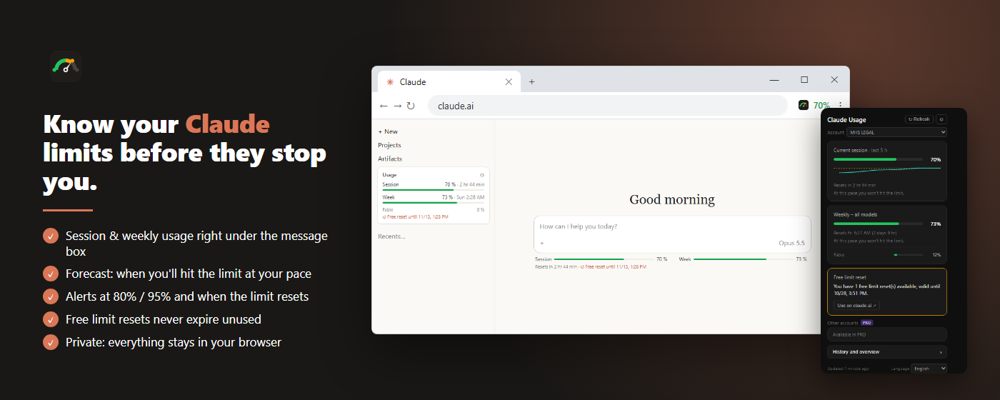

# Usage Meter for Claude

**See your Claude usage limits right in the browser toolbar** – the 5-hour session limit and the weekly limits, with reset times, a forecast of when you'll run out and alerts before you hit the limit. Includes usage from Claude Code, the Claude desktop app and your phone.

**Install (free):**
[Chrome](https://chromewebstore.google.com/detail/jligjaaoimlmiplpkofebackmpgnjgib) ·
[Microsoft Edge](https://microsoftedge.microsoft.com/addons/detail/bifgmogjmocglmlbkmgmcjnepfjochog) ·
[Firefox](https://addons.mozilla.org/firefox/addon/usage-meter-for-claude-ai/)

**Website:** https://usagemeterclaude-source.github.io/usage-meter-for-claude/ · **50-second demo:** https://www.youtube.com/watch?v=JG96MamvYg8

## Features

- **Usage on the toolbar icon** – green, orange or red, showing the higher of your session and weekly usage
- **Popup** with the current session, weekly and per-model limits and when each one resets
- **Forecast** – when you'll hit the limit at your current pace, including the day your weekly limit runs out
- **Right on claude.ai** – your usage under the message box and in the sidebar
- **Notifications** at 80 % and 95 % (adjustable), when a limit resets and before a free limit reset expires
- **History chart** and weekly overview compared with last week
- **Claude Code, desktop app and phone** – all count towards the same limits, and the extension refreshes in the background
- **27 languages**, light and dark mode

Works with Claude Pro, Max and Team. Free to use; PRO (€0.99/month or €7.99/year, 7-day free trial) adds 30/60-day history, several accounts at once and CSV export.

## Privacy

The extension only reads your own usage percentages from claude.ai using the session you are already signed in with. It does not read your conversations, nothing is sent to the developer and there is no analytics. All data stays in your browser. Full [privacy policy](https://usagemeterclaude-source.github.io/usage-meter-for-claude/privacy.html).

## Guides

- [How to check your Claude usage limits (session, weekly & Claude Code)](https://usagemeterclaude-source.github.io/usage-meter-for-claude/claude-usage-limits.html)
- [Why do I hit the Claude usage limit so fast? 10 reasons and fixes](https://usagemeterclaude-source.github.io/usage-meter-for-claude/why-claude-limit-runs-out.html)
- [Claude Pro vs Max vs Ultra: how much usage do you get?](https://usagemeterclaude-source.github.io/usage-meter-for-claude/claude-pro-vs-max-vs-ultra.html)

Also in [Slovenčina](https://usagemeterclaude-source.github.io/usage-meter-for-claude/sk/) · [Čeština](https://usagemeterclaude-source.github.io/usage-meter-for-claude/cs/) · [Deutsch](https://usagemeterclaude-source.github.io/usage-meter-for-claude/de/) · [Italiano](https://usagemeterclaude-source.github.io/usage-meter-for-claude/it/) · [Français](https://usagemeterclaude-source.github.io/usage-meter-for-claude/fr/)

## Feedback

Missing something? [Suggest an improvement](https://usagemeterclaude-source.github.io/usage-meter-for-claude/feedback.html?t=idea&l=en) or write to usagemeter.claude@gmail.com.

---

This repository hosts the extension's website (GitHub Pages). Unofficial extension, not affiliated with or endorsed by Anthropic. Claude is a trademark of Anthropic, PBC.
